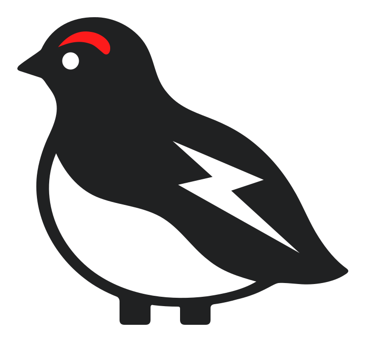
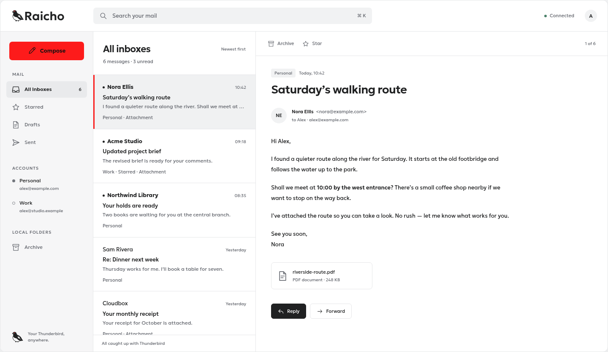

<p align="center">
  <picture>
    <source media="(prefers-color-scheme: dark)" srcset="assets/brand/logos/mark-dark.svg">
    
  </picture>
</p>

<h1 align="center">Raicho</h1>

<p align="center">Your Thunderbird, anywhere.</p>

<p align="center">
  <a href="#getting-started">Getting started</a> ·
  <a href="#architecture">Architecture</a> ·
  <a href="#contributing">Contributing</a>
</p>

Raicho is a browser interface for Thunderbird, designed to let you use your
mail from other computers while Thunderbird keeps your accounts, messages,
and filters. The goal is to run Raicho and Thunderbird together on your own
machine and open your mail in a browser wherever you work.

> **In development.** The containerized foundation runs a Rust/SQLite diagnostics
> server, a TypeScript status page, and our own Thunderbird image. The browser
> mail client and login are not implemented yet. The packaged extension supports
> an authenticated control connection and connection diagnostics.

## Why Raicho

Thunderbird brings your email accounts and local mail together in one place.
Accessing that setup from another computer currently means using a remote
desktop or maintaining another mail client.

Raicho aims to give that same Thunderbird instance a browser interface.
Thunderbird remains responsible for your mail and filters, so your existing
setup stays at the center of the experience.

## What it looks like

The inbox below is an **interface concept with fictional messages**. Its
interactions use sample data, and it does not connect to an email account.

<picture>
  <source media="(prefers-color-scheme: dark)" srcset="assets/brand/previews/inbox-dark.png">
  
</picture>

The [showcase guide](assets/brand/showcase/README.md) explains how to preview
the concept locally, including light and dark themes and the mobile layout.
The [brand guide](assets/brand/README.md) covers the logo, colors, and typography.

## Getting started

Install Git and Docker with Compose, then clone the repository. On Linux amd64,
build and start the foundation from the repository root:

```bash
docker compose -f compose/compose.yaml build
docker compose -f compose/compose.yaml up -d --wait
```

Open <http://127.0.0.1:8080> for diagnostics. Thunderbird starts without a viewer,
with its profile in a separate persistent volume. The connector starts
unconfigured. Follow the [credential setup](docs/operations/connector-credentials.md)
to establish its authenticated connection. The
[local runtime guide](docs/operations/local-runtime.md) covers optional browser
administration, disposable profiles, persistence checks, and stopping services.

Build the tooling image and run development checks separately:

```bash
docker compose -f compose/compose.tools.yaml build
docker compose -f compose/compose.tools.yaml run --rm check make lint format-check typecheck
```

The tooling image provides the language tools and Python test fixtures, so host
language toolchains are not required. The `check` service does not start runtime
services.

Docker recipes and their build-context filters live in `containers/`, deployment
definitions in `compose/`, and tests beside their owning components. See
[project structure](docs/reference/project-structure.md) for the layout.
The shared connector protocol has Rust and TypeScript implementations under
`protocol/`.
Repository guards enforce the [source and directory naming conventions](docs/coding/coding-standards.md).

See [build, test, and generate](docs/reference/build-test-generate.md) for
formatting, additional checks, and Git worktree setup.

## Architecture

The planned application has three components:

- A **TypeScript browser client** for reading and managing mail.
- A **Rust server** that serves the client and connects it to a mail backend.
  Embedded SQLite stores Raicho's login, preferences, and connector state.
- A **TypeScript extension inside Thunderbird** that connects to the server.
  Thunderbird owns mail, drafts, account credentials, and filters.

Docker Compose runs the server and Thunderbird as separate services with
persistent volumes. Each deployment serves one person. The planned backend boundary
allows other implementations later, with Thunderbird as the initial focus.

The [architecture guide](docs/reference/architecture.md) explains the current
and planned systems. The
[foundation plan](docs/planning/active/20261017-thunderbird-first-foundation.md)
records the implementation stages and open choices.

## Contributing

Anyone can contribute. Start with the
[contributor guide](docs/contributing/getting-started.md) and
[delivery workflow](docs/contributing/workflow.md). Substantial changes begin
with a design pull request before implementation.

The [project structure](docs/reference/project-structure.md) explains where image
recipes, runtime code, configuration, tests, and developer commands belong.

[AGENTS.md](AGENTS.md) is the entry point for AI-assisted work, and
[decision records](docs/decisions/README.md) explain the project's choices.

## License

[MIT](LICENSE). The bundled Geologica font files are licensed separately under
the [SIL Open Font License 1.1](assets/brand/fonts/OFL.txt).
