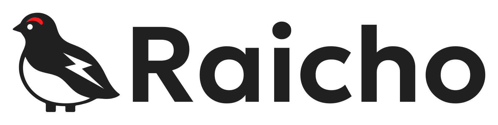

# Raicho brand assets

Your Thunderbird, anywhere.



## Logos

The SVGs contain editable vector paths with outlined lettering. They have no
embedded raster images, external resources, or font dependencies. Each PNG is
exported from its matching SVG with a transparent outer canvas.

| Layout | Light background | Dark background | PNG width |
| --- | --- | --- | --- |
| Bird | [SVG](logos/mark.svg) / [PNG](logos/mark.png) | [SVG](logos/mark-dark.svg) / [PNG](logos/mark-dark.png) | 1024 px |
| Wordmark | [SVG](logos/wordmark.svg) / [PNG](logos/wordmark.png) | [SVG](logos/wordmark-dark.svg) / [PNG](logos/wordmark-dark.png) | 1024 px |
| Stacked | [SVG](logos/stacked.svg) / [PNG](logos/stacked.png) | [SVG](logos/stacked-dark.svg) / [PNG](logos/stacked-dark.png) | 1024 px |
| Horizontal | [SVG](logos/horizontal.svg) / [PNG](logos/horizontal.png) | [SVG](logos/horizontal-dark.svg) / [PNG](logos/horizontal-dark.png) | 1600 px |

Use the SVG for new sizes. All bird variants share the same geometry, including
the two short, thick legs. The white eye, belly, and lightning remain opaque
white on a transparent canvas. Dark variants add an exterior white keyline and
use white lettering; place them on charcoal or another dark background.

Keep proportions unchanged and leave at least one eye diameter of clear space
around the visible logo. As a starting point, use the complete logo at 128 px
wide or larger and the bird at 24 px or larger. Check legibility in the actual
placement, especially when the mark appears smaller.

## Icons

| Asset | Files | Background |
| --- | --- | --- |
| Light app icon | [192 px](icons/app-light-192.png), [512 px](icons/app-light-512.png) | Opaque white square |
| Dark app icon | [192 px](icons/app-dark-192.png), [512 px](icons/app-dark-512.png) | Opaque charcoal square |
| Apple touch icon | [180 px](icons/apple-touch-icon.png) | Opaque white square |
| Adaptive favicon | [SVG](icons/favicon.svg) | Transparent; white exterior keyline in dark mode |
| Fallback favicon | [ICO](icons/favicon.ico) | White tile with transparent rounded corners |

The ICO contains 16, 24, 32, 48, and 64 px images. The smallest favicon prioritizes
the bird silhouette; use the larger mark when individual details need to read.
App icons use square canvases so the platform can apply its own corner shape.

Example paths when this directory is served at `/assets/brand/`:

```html
<link rel="icon" href="/assets/brand/icons/favicon.ico" sizes="any">
<link rel="icon" href="/assets/brand/icons/favicon.svg" type="image/svg+xml">
<link rel="apple-touch-icon" href="/assets/brand/icons/apple-touch-icon.png">
```

## Color

| Color | Value | Use |
| --- | --- | --- |
| Charcoal | `#202122` | Bird, lettering, dark surfaces |
| Vermilion | `#FD1B1B` | Brow and brand accent |
| Snow | `#FFFFFF` | White details and light surfaces |
| Mist | `#D9DADD` | Supporting neutral |

Charcoal and vermilion are flattened samples from the approved standalone
logo. Snow and mist are supporting palette choices based on the identity board.
The reference PNGs retain their original texture and color variation.
Use [tokens.css](tokens.css) for the shared palette and typography tokens.

## Typography

The wordmark uses **Geologica at weight 580**, with the single-storey “a”
(`ss01`) and natural letter spacing. Its paths come directly from the Google
Fonts typeface, with the font's kerning applied. Use the supplied wordmark SVG
when displaying the logo.

| Purpose | Geologica weight |
| --- | --- |
| Body text | 400 |
| Headings | 700 |
| Wordmark / display text | 580 |

The variable font supports weights 100–900. Use
[Geologica-Variable.ttf](fonts/Geologica-Variable.ttf) in design tools and
[Geologica-Variable.woff2](fonts/Geologica-Variable.woff2) on the web.
[fonts.css](fonts/fonts.css) provides the upright `@font-face` declaration
and enables `ss01` by default. In design tools, enable stylistic set 1 and
set `CRSV`, `SHRP`, and `slnt` to 0 to reproduce the chosen upright style.

```css
@import url("./fonts/fonts.css");
@import url("./tokens.css");

body {
  font-family: var(--raicho-font-family);
  font-weight: var(--raicho-font-weight-body);
  font-feature-settings: var(--raicho-font-feature-settings);
  font-variation-settings: var(--raicho-font-variation-settings);
}

.brand-display {
  font-weight: var(--raicho-font-weight-display);
  letter-spacing: normal;
}
```

## Sources and licensing

- [Approved standalone logo](references/approved-logo.png): the original bird
  geometry reference. Curves and straight edges were cleaned to remove raster
  irregularities. Its generated lettering is historical; production logos now
  use Geologica outlines.
- [Approved identity board](references/approved-identity-board.png): retained
  unchanged as a visual reference. Its smaller illustrations contain redraw
  differences and its lettering predates the Geologica selection. Production
  bird variants all derive from the standalone logo.
- [Font sources and checksums](fonts/SOURCES.md): pinned upstream URLs,
  Google Fonts URLs, web font conversion details, and SHA-256 checksums.

The repository's [MIT license](../../LICENSE) covers the Raicho materials.
The bundled Geologica font files retain their separate
[SIL Open Font License 1.1](fonts/OFL.txt); include that license when redistributing
the fonts. The font license does not change the license of artwork made with it.
