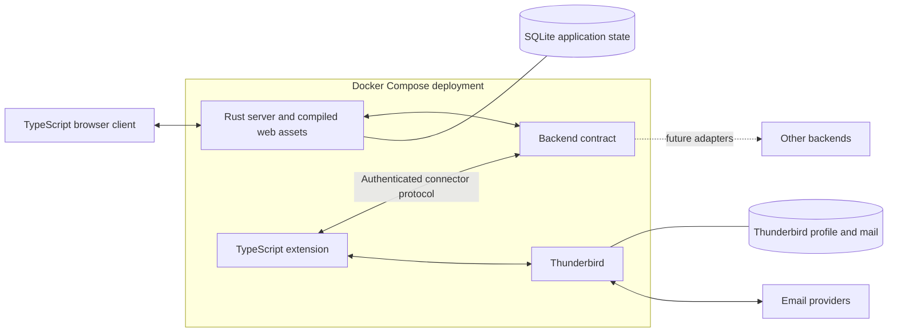

# Thunderbird-first foundation

Status: stage 1 implementation and Docker validation are complete. Publication
with the Compose/SQL follow-up was authorized on 2026-10-18. Later foundation
stages require their own authorization.

The accepted constraints are recorded in the
[foundation decision](../../decisions/20261017-thunderbird-first-foundation.md) and
[SQLite decision](../../decisions/20261018-sqlite-application-state.md).

## Goal

Build a browser mail client for one person with multiple accounts, using a Rust server, a TypeScript web client, and a TypeScript Thunderbird extension. Docker Compose runs the complete application from the first working stage. Thunderbird owns mail storage, account connections, drafts, and filters. Raicho provides the web interface without creating another mail store or rule engine. The foundation is complete when the browser can read, search, organize, draft, and send test mail through Thunderbird, recover from container restarts, and demonstrate persistent Thunderbird data without persistent mail copies in Raicho.

## Approach

### Accepted scope and current state

- One user per deployment, with multiple browser sessions and email accounts. Multiple users deploy separate Compose projects with separate volumes, credentials, and ports. Shared tenancy is outside this plan.
- Rust powers the application server, with embedded SQLite for Raicho's operational state. Both the browser client and extension use TypeScript. Docker covers runtime, builds, development tooling, and validation from the beginning.
- Thunderbird is the primary and foreseeable mail backend. It owns its local stores and communication with upstream providers. Raicho does not become an SMTP/IMAP server or connect independently to those same accounts.
- Thunderbird owns filters and their execution. Raicho does not copy rule definitions, run a second filter engine, or edit Thunderbird's profile files directly.
- The repository began with branding, a static fictional-mail showcase, documentation, repository guards, and containerized code-quality tooling. Stage 1 adds the diagnostics runtime and independent Thunderbird image. Reuse the approved identity assets without treating showcase behavior as mail functionality.

Shared tooling was brought forward under the [code-quality decision](../../decisions/20261018-containerized-code-quality.md). Its [current commands](../../reference/build-test-generate.md) and [pins](../../coding/linting-and-formatting.md) are implemented independently. This does not complete application stage 1 or any later stage below.

### Components and extensibility

Use Axum and Tokio for one server process serving browser assets, APIs, and future connector traffic. The extension initiates an outbound connection to the server's Compose service hostname. WebSocket is the first transport candidate, subject to the lifecycle experiment in stage 2. The server remains available when Thunderbird is disconnected and reports backend status separately from its own readiness.

Keep browser APIs independent of Thunderbird. Define a versioned, language-neutral connector schema with runtime validation and generated or mechanically checked Rust/TypeScript types. Implement the Thunderbird adapter and a small mock backend first. Use ordinary Rust modules/traits for bundled adapters and the protocol for external connectors. A dynamic plugin loader, additional production backends, and full JMAP implementation are outside this foundation.

The contract covers accounts and identities, mailbox memberships, message summaries/content, attachments, search, flags, moves, drafts, and sending. Advertise optional capabilities and permissions per account/mailbox, distinguishing unsupported operations from temporary disconnection. Keep provider-specific objects behind the adapter. JMAP is a modeling reference, not a wire-protocol commitment.

Use opaque backend-scoped handles with an explicit connection generation. Thunderbird message IDs are transient, and folder IDs change after rename/move. Stale handles must fail and trigger re-resolution/refetch after these changes or a restart, never select another object silently. Do not use a Message-ID header as a universal primary key. Scope query cursors to their session. Reconnects reconcile current state rather than assuming events form a replayable journal.

Bound pagination, message/frame sizes, attachment transfers, and queues. Include request correlation, deadlines, cancellation, per-item mutation results, and explicit error categories. Distinguish rejected, queued, sent, and unknown send outcomes. A disconnected request may have completed in Thunderbird, so do not automatically replay mutations or resend mail after uncertainty.

### Ownership and persistence

| Storage | Owner and proposed mount | Allowed contents |
| --- | --- | --- |
| `raicho-data` | Rust server, `/var/lib/raicho` | SQLite database and its journal/WAL files: login/session state, application preferences, backend configuration, connection credentials, and schema migration records |
| `thunderbird-data` | Thunderbird only, `/config` for either candidate image | Profile, mail stores, accounts, provider credentials, filters, drafts, extension state |

Use named volumes by default and document equivalent bind mounts. Only one Thunderbird process owns a profile. Any mail-store paths configured outside its profile must also be explicitly mounted and included in backups. The Rust container never mounts the profile. Container recreation must preserve both volumes, while separate installations must not share them.

Run SQLite inside the Rust process, with its database and any journal/WAL files together under `/var/lib/raicho` on a local filesystem. Network filesystems such as NFS/SMB are outside the supported deployment. Thunderbird and the browser access Raicho state only through server APIs. Keep database access in a focused Rust persistence module, separate from the mail-backend contract. SQLite is the sole application database in this foundation.

Introduce versioned schema migrations with database initialization in stage 1, then add application tables with the stages that use them. Application readiness requires successful initialization and migration to a supported schema. Reject migration failures or unsupported schemas without replacing existing data. Keep write transactions short and handle contention from multiple browser sessions within the server.

Raicho does not persist message headers, bodies, attachments, draft content, search indexes, or filter definitions. This also excludes a mailbox catalogue, mail flags, and a persistent message-handle mapping. Request/render buffers and bounded in-memory handles are transient implementation necessities. Keep payloads out of logs, traces, disk spools, and application caches. Stream attachments with limits rather than creating a second on-disk store. Explicit user downloads are normal client exports.

Search runs through Thunderbird's supported query facilities. Draft saves and archive actions operate on Thunderbird's configured folders and policies. Unsaved compose content exists only in browser memory until saved through Thunderbird. Show a draft as saved only after Thunderbird acknowledges it. If required draft or search behavior is unavailable through the selected API, report the limitation and resolve the design before implementing it elsewhere. Filter management initially uses Thunderbird's administrative desktop. A future web editor must operate on Thunderbird's rules through a verified API.

With Thunderbird disconnected, the web UI still loads and reports status. Previously rendered content may remain temporarily in memory, clearly stale, but mail operations and new mail retrieval are unavailable. There is no offline mailbox, independent retention service, or server-side send queue. Upstream-provider outages may still permit access to mail Thunderbird has downloaded, according to its own account settings.

Serve sensitive responses with `Cache-Control: no-store`. Do not persist mail in browser storage or service-worker caches, and clear in-memory mail on logout. Thunderbird's existing archive behavior remains authoritative. A mounted profile provides persistence, not a new backup or source-deletion retention guarantee.

### Container operation and access

Compose starts two core services: `raicho` and `thunderbird`. SQLite is embedded in `raicho` and needs no separate database service. Build the browser and XPI in a Node stage and the server in a Rust stage, then ship only required runtime artifacts. Reuse the pinned development toolchains and pin application dependency lockfiles, SQLite dependency/version, base-image digests, and the tested Thunderbird/extension combination. Contributors need Docker and Compose for the documented commands, without host Rust, Node, SQLite, or Thunderbird installations.

Build our own Thunderbird image directly from Debian with the official ESR archive, Xvfb, Openbox, and opt-in noVNC administration. The maintainer chose independent packaging after the image comparison. Pin the base digest, package snapshot, and downloaded archives. Keep the browser desktop for account setup, OAuth prompts, filter editing, and recovery. Publish its port only through an explicit local/admin override. The default user interface is Raicho. Package the extension in this image during stage 2 and verify policy-based installation rather than assuming that copying an XPI activates it.

Stage 1 uses separate Compose bridge networks for Raicho and Thunderbird, both with provider internet access. Review identified that a shared network allowed Raicho to reach Thunderbird's administrative listener despite its loopback host publication. The separation closes that path. Stage 2 must provide an outbound connector route to the server without exposing administration to Raicho. Authenticate connector sessions independently of browser login. Stage 1 exposes only diagnostics on loopback by default. Before mail access, implement a single-user login, protected session cookies, mutation CSRF/origin checks, and connector credential provisioning. Document HTTPS through a reverse proxy for remote use. Internal health checks must not depend on Thunderbird being connected.

Graceful shutdown, connection backoff, and reconciliation handle ordinary restarts. Persisted profiles need stopped-profile backup/restore procedures, including external mail directories. Test upgrades with disposable profiles before migration. Do not assume rolling back an image also rolls back profile changes. No existing personal profile is imported or mounted during foundation tests.

Back up Raicho's SQLite state separately using a database-supported consistent backup, or stop the Rust server before copying the complete state directory with any journal/WAL files. Copying only a live database file is not a supported backup. Restore with the Rust server stopped and verify the schema and operational state before serving requests. Document backup and recovery before schema upgrades, since rolling back a server image does not undo a migration. Stage 7 verifies restoration of both Raicho state and Thunderbird data.

### Proposed source layout

Stage 1 introduces `server/` for the Rust application, persistence and migrations, `web/` for TypeScript diagnostics, application recipes under `containers/`, runtime Compose files, and an opt-in administrative override. Stage 2 adds `extension/` for Thunderbird integration and `protocol/` for connector schemas. Keep `assets/brand/` as the identity source. Update reference/coding docs, Make targets, CI, and ADRs with the stages that introduce actual behavior.

### Approved stage 1 implementation

The [runtime stack decision](../../decisions/20261018-foundation-runtime-stack.md)
records Axum/Tokio, SQLx with bundled SQLite, Linux amd64, and independent
Thunderbird packaging. The approved implementation sequence is:

1. Rust configuration, health/status routes, process lock, SQLite initialization,
   and migration failure tests. Add executable build/test targets with sources.
2. Framework-neutral TypeScript diagnostics, branded assets, runtime response
   validation, and bounded polling tests.
3. Separate application and Thunderbird images, persistence volumes, local
   administration, nonroot operation, and bounded process shutdown.
4. Containerized application and runtime CI checks, preserving repository guards.
5. Disposable HTTP/profile/database recreation checks, browser inspection, and
   documentation reconciliation before the stage 2 review checkpoint.

Exact commands and runtime settings live in
[build commands](../../reference/build-test-generate.md) and
[local operation](../../operations/local-runtime.md). Tests use no personal
profiles, credentials, or provider sends. No commit or push is authorized by
the stage implementation approval.

## Open questions

- Stage 1 stack choices are resolved in the runtime decision above. Extension compatibility with the selected Thunderbird release remains a stage 2 gate. ARM64 requires a separately validated packaging route.
- Before stage 2 acceptance: prove extension installation/upgrade, background lifetime, reconnect behavior, and secure connector credential provisioning. Establish the connector route while retaining administrative network isolation. Choose a supported manifest/lifecycle strategy from the results. WebSocket availability alone does not guarantee an always-running background context.
- Before stage 3: settle browser login/bootstrap, HTTPS deployment details, and the UI framework. Before stage 4: select the safe message-rendering approach. Ground these choices in the diagnostic client and brand assets.
- Before stages 4 and 6: record supported search, draft, and send semantics for the pinned Thunderbird version, including attachment limits and any native compose interaction. Do not claim the newest background-send API exists in an older container image.
- These are implementation gates, not reopened product choices. Resolve each before its dependent stage. If a solution requires a mail replica, duplicated filters, a privileged Experiment, or a separate host daemon, stop and propose a revised design.

## Stages

Each stage includes focused behavioral tests where applicable and ends with a review checkpoint before the next stage. Commands for unimplemented stages remain proposed until their services exist. Stage 1 commands are implemented in the [build reference](../../reference/build-test-generate.md). Use the existing tooling services for language and repository checks, and add application checks to CI in the stage that introduces them. Future build, test, and coverage labels are listed under [Future CI jobs](#future-ci-jobs). Keep test profiles and local mail fixtures isolated from personal accounts.

- [x] Stage 1: Boot the containerized foundation.
  Add the Rust health/status server, framework-neutral TypeScript diagnostic page, multi-stage images, application Compose services, separate volumes, and administrative override. Extend the existing developer commands and CI with application build/test checks. Add the Cargo and TypeScript project configuration with the first sources so the existing language runners become active. Initialize SQLite through the persistence module with versioned migrations and schema readiness checks. Pin application dependencies/images and document current versus target architecture.
  Verification: validate Compose, build/start a disposable deployment, open diagnostics, inspect Thunderbird through the administrative endpoint, and recreate containers to check profile and SQLite persistence and startup without a viewer. Exercise fresh database initialization, migration success/failure, and rejection of unsupported schemas without data loss.
  Quality gate: `docker compose config --quiet`, `docker compose build`, and Rust format/Clippy, TypeScript type/build, repository checks, and focused persistence/migration tests inside tooling containers. Record image/version/platform evidence. Stop for review of the runnable foundation and stage 2 experiment.
  Debrief (2026-10-18): implemented Rust/SQLite diagnostics, the TypeScript page, and our own Debian-based Thunderbird image as explicitly requested. All 88 repository/tooling/application/supervisor tests and quality checks passed in Docker. Disposable recreation preserved SQLite contents and Thunderbird preferences, Raicho remained ready with Thunderbird stopped, and browser inspection confirmed desktop/mobile diagnostics and the native administrative desktop. No extension or mail workflow is claimed. Stage 2 awaits review.
- [ ] Stage 2: Prove the extension lifecycle and connector.
  Package/install the extension, authenticate its outbound connection, define the minimal versioned handshake/capability schema, and report connection state in diagnostics. Add migrations for Raicho-owned connector configuration and pairing state in SQLite. Keep mail APIs unavailable to the browser. Exercise the selected version's draft/send APIs against local test infrastructure to identify incompatibilities early.
  Verification: extension activation without a viewer, invalid credentials/protocol rejection, idle-background behavior, restart either container, network interruption, bounded backoff, credential persistence/rotation, draft save/reopen/edit/resave, and queued versus sent outcomes. Record limitations and resolve the lifecycle/transport gate.
  Quality gate: containerized Rust/TypeScript checks and focused protocol/recovery tests. No real-provider sends. Stop for review of protocol evidence, pairing design, and compatibility matrix.
- [ ] Stage 3: Deliver authenticated account and mailbox browsing.
  Implement single-user login, session protection, the backend contract, Thunderbird adapter, mock backend, account identities, mailbox listing, and paginated message summaries in the selected UI framework. Enforce ownership/capabilities and session-scoped handles. Add SQLite migrations for login/session state and application preferences within the ownership boundary above.
  Verification: login/logout, unauthorized browser/connector access, persisted settings and session revocation across restarts, concurrent browser sessions, mailbox pagination, mock-adapter substitution, stale handles after restart/message move/folder rename, disconnect status, and absence of mail data in SQLite/logs/browser persistence.
  Quality gate: containerized checks and contract/authentication tests, then browser smoke checks against disposable mail fixtures. Stop for review of the first useful mailbox view.
- [ ] Stage 4: Read messages, download attachments, and search.
  Extend the UI using the existing brand, implement safe plain/HTML message views with isolated sanitized HTML and remote content blocked by default, bounded attachment transfer, and Thunderbird-backed search with declared limitations.
  Verification: malicious HTML fixtures, blocked scripts/remote content, MIME/attachment handling, cancellation/size limits, search pagination, multi-account results, stale views, and no persisted mail cache.
  Quality gate: containerized checks, rendering/query tests, and browser accessibility/responsive checks. Stop for review of usable read/search workflows and privacy behavior.
- [ ] Stage 5: Organize mail through Thunderbird.
  Add read/unread, supported tags, move, trash, and archive operations with capability checks and explicit partial failures. Display results after Thunderbird reconciliation. Keep its existing filters and archive policy authoritative.
  Verification: folder changes and native Thunderbird filters reflected in the browser, same-message actions from two browser sessions, partial failures, stale handles, and disconnect after submission without automatic replay.
  Quality gate: containerized checks and mutation integration tests with disposable folders/messages. Stop for review of organization behavior and the absence of a second rule engine.
- [ ] Stage 6: Compose, save drafts, reply, and send.
  Add identity selection, replies/forwarding, bounded uploads, Thunderbird-owned drafts and sending, and honest queued/sent/unknown states. Surface unsupported behavior rather than adding a Raicho draft store or outbox.
  Verification: draft save/reopen in Thunderbird, attachments, selected sender, rejected/queued/sent outcomes, unsaved changes, restart during compose, and an uncertain send that never causes an automatic duplicate. Use an isolated mail service, not personal accounts.
  Quality gate: containerized checks and compose/send integration tests. Stop for review of the minimum daily mail workflow and any API-driven limitations.
- [ ] Stage 7: Verify operations and finish the foundation.
  Document setup, HTTPS, filter administration, mount ownership, SQLite and Thunderbird backups/restores, schema upgrades/recovery, pinned upgrades, and independent installations. Verify CI runs the same containerized checks and reconcile reference docs/ADRs with implemented behavior.
  Verification: clean-host Compose startup, full browser workflow, restart/recreate, consistent SQLite backup and restore of operational state, stopped-profile backup and restore, schema upgrade/recovery, rejected incompatible extension versions, and two isolated deployments. Inspect the SQLite database and logs after the workflow for forbidden mail data.
  Quality gate: documented containerized check suite, end-to-end fixture workflow, containerized `make lint-repo`, and `git diff --check`. Review evidence and limitations, then move this plan to `docs/planning/done/` with the final implementation commit.

## Future CI jobs

Stage 1 implements application build and test jobs with the label behavior
below. Coverage and release checks remain future work. Use the same commands
locally and in CI, and do not add empty jobs.

- `design` pull requests skip future application build, test, coverage, and release jobs. Repository integrity checks still run.
- `skip-build` skips the application build job when the diff cannot affect it.
- `skip-test` skips test jobs and jobs that depend on them.
- `skip-coverage-check` skips only a future patch-coverage gate.
- Expose patch coverage through `make check-patch-coverage`. Require 90% of changed executable lines, excluding tests, generated files, and vendored code.

Repository integrity checks never skip because of a label.

## Notes

- Repository grounding: [architecture](../../reference/architecture.md), [project structure](../../reference/project-structure.md), [delivery workflow](../../contributing/workflow.md), and [brand guide](../../../assets/brand/README.md).
- Authoritative API references: [supported Thunderbird APIs](https://developer.thunderbird.net/add-ons/mailextensions/supported-webextension-api), [messages and transient IDs](https://webextension-api.thunderbird.net/en/mv3/messages.html), [folder IDs](https://webextension-api.thunderbird.net/en/mv3/folders.html#mailfolderid), [compose API](https://webextension-api.thunderbird.net/en/mv3/compose.html), [Manifest V3 lifecycle](https://developer.thunderbird.net/add-ons/whats-new/manifest-v3), and [extension deployment policies](https://thunderbird.github.io/policy-templates/policies/esr140/#extensionsettings). Recheck against the selected release.
- Deployment references: [jlesage image](https://github.com/jlesage/docker-thunderbird), [LinuxServer image](https://docs.linuxserver.io/images/docker-thunderbird/), [profile ownership/backups](https://support.mozilla.org/en-US/kb/profiles-where-thunderbird-stores-user-data), [Compose networking](https://docs.docker.com/compose/how-tos/networking/), and [multi-stage builds](https://docs.docker.com/build/building/multi-stage/).
- Design references: [Axum](https://docs.rs/axum/latest/axum/), [Tokio](https://tokio.rs/tokio/tutorial), [JMAP core](https://www.rfc-editor.org/rfc/rfc8620.html), and [JMAP mail](https://www.rfc-editor.org/rfc/rfc8621.html). These guide the proposed implementation and do not select a frontend framework or require full JMAP support.
- SQLite references: [deployment suitability](https://sqlite.org/whentouse.html), [consistent backups](https://sqlite.org/backup.html), and [filesystem and journal requirements](https://sqlite.org/howtocorrupt.html). The selected Rust integration must preserve these guarantees.
- Stage 1 approval includes source checks, application tests, Docker builds, disposable startup/recreation, and browser inspection. The maintainer authorized publication with the Compose/SQL follow-up. Later foundation stages remain subject to stage-specific approval.
