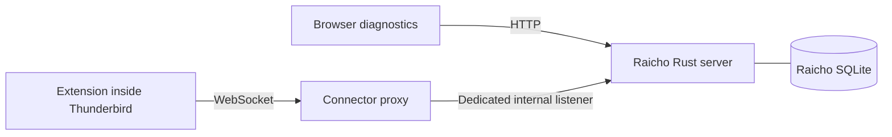

# Foundation Stage 2: Thunderbird connector

Status: approved design [PR #2](https://github.com/woswos/raicho/pull/2) merged on
2026-10-18. Packaging/lifecycle and the mail API experiment are committed. The
minimal connector contract is implemented and awaits review. Mail compatibility
limitations remain gates before dependent compose work.

## Goal

Complete Stage 2 of the [foundation plan](20261017-thunderbird-first-foundation.md)
with an unattended, authenticated connection between the packaged Thunderbird
extension and Raicho. Demonstrate installation, upgrades, bounded recovery,
credential management, and diagnostic status against the pinned Thunderbird
image. Record draft and send API behavior using disposable local mail fixtures.
Acceptance requires review of the evidence and unresolved API limitations.

## Approach

### Scope and repository grounding

Keep the accepted single-user Rust/SQLite architecture and Thunderbird ownership
boundary in the foundation plan. This stage adds `extension/`, `protocol/`,
connector modules under `server/src/`, application-state migrations and queries,
and a connector proxy recipe under `containers/`. Extend runtime configuration
under `compose/`, the diagnostics in `web/`, Docker tooling, and CI as needed.

The existing `containers/thunderbird/runtime.py` owns Thunderbird startup and
will gain policy preparation. The Rust server never mounts or edits its profile.
Production Stage 2 exposes connection diagnostics only. Mail probes and their permissions
belong to a separate test artifact. Browser login, mailbox APIs, rendering, and
production compose workflows remain in their later foundation stages.

### Extension packaging and lifecycle

Use a Manifest V2 persistent background page on Thunderbird 153.5.0 ESR. Both
manifest versions are supported, but MV3 event pages can suspend while idle.
Keep the implementation restart-safe without relying on undocumented keepalive
behavior. MV3 can be reconsidered with separate lifecycle evidence.

Build TypeScript and a deterministic XPI in Docker. Use a stable extension ID,
a versioned local XPI path, and `ExtensionSettings` with `force_installed` and
`updates_disabled: true`. Verify that this combination actually upgrades an
existing profile. Do not assume replacing the image activates the new XPI.

Read endpoint and credential configuration through `messenger.storage.managed`.
Before starting Thunderbird, generate the complete policy file atomically with
mode `0600` in its private runtime tmpfs directory. Preserve existing policies.
A baked symlink at the normal policy path points to this generated file. Policy
loading through the symlink and permanent unsigned installation are explicit
tests against the pinned image. Credentials never enter image layers or XPIs.

### Connector route



Add a fixed Nginx proxy as a third production Compose service. Raicho stays on
`application`, Thunderbird stays on `thunderbird`, and only the proxy joins both.
The proxy has no published port, data volume, credentials, or mail logic. It is
trusted infrastructure with access to Thunderbird's network. This arrangement
preserves the existing protection against direct access from Raicho.

Proxy only the exact `/connector/v1` WebSocket route to the dedicated Rust
listener. Reject alternative paths, arbitrary destinations, and `CONNECT`.
Keep the connector unavailable on the browser-facing HTTP listener. Disable
payload logging and caching. Pin the proxy image and run it without root or
capabilities, with a read-only filesystem and bounded temporary storage.

Configure upstream DNS refresh for recreated Raicho containers, using Docker's
resolver and Nginx dynamic upstream resolution. Align proxy timeouts with the
heartbeat. A shared network for both core services would expose other ports.
A Unix-socket proxy would add shared-volume and socket recovery requirements,
so it is not the initial deployment.

### Protocol and credentials

Use JSON Schema as the language-neutral contract under `protocol/`. Generate
Rust and TypeScript bindings with `typify` and `json-schema-to-typescript`.
Validate messages with Rust `jsonschema` and build-time Ajv standalone validators
in the extension. Use a small schema vocabulary supported by both generators,
local references only, pinned dependencies, and generated-output drift checks.
Shared valid and invalid fixtures must exercise both implementations.

The implemented [control contract](../../reference/connector-contract.md) uses
Draft 7, empty capabilities, strict duplicate-member rejection, bounded JSON
depth, printable ASCII control fields, and phase/generation validation. Its Ajv
standalone output is bundled with build-only esbuild so Thunderbird needs no
runtime imports or dynamic code generation. These source modules do not activate
the production transport or verify credentials.

Define authentication, protocol negotiation, capabilities, heartbeat, connection
generation, and error messages. Advertise only implemented capabilities. Keep
production mail commands outside this stage. Initial defaults to validate are a
five-second authentication deadline, a 4 KiB authentication message, 64 KiB
control messages, and bounded connection counts, buffers, and queues. Reject
invalid versions and messages before registering an active connector.

Authenticate with a random 256-bit per-installation token in the first message,
never in URLs or subprotocol names. Compare credential digests in constant time.
Origin checks supplement authentication and reject ordinary browser origins.
Determine the extension's actual Origin behavior in the lifecycle experiment.
Private same-host Compose traffic uses `ws://`. Remote connectors require a
separate design with verified `wss://` transport.

A Docker-based setup command creates an ignored host secret file without
printing it, before starting services that require it. Mount the raw credential
read-only into Thunderbird and the one-off provisioning command. The normal
server needs only the SQLite digest. Verify host-file permissions and readability
by UID 10001, since file-backed Compose secrets do not remap ownership or mode.
The host secret and generated Thunderbird policy necessarily contain plaintext.

Add explicit `connector init`, `connector rotate`, and `connector revoke`
operations using the existing exclusive database lock while Raicho is stopped.
Normal startup never imports a credential or re-enrolls a revoked one. Rotation
stops both core services, prepares the replacement file, updates the database,
and recreates the services before verifying the new credential. File replacement
and SQLite changes are separate operations. Define fail-closed repair steps for
interruption or mismatch, preserving the last committed configuration until
verification. Never silently accept both old and new credentials.

Persist backend configuration and credential digests/revocation state, without
mail data. Keep active connections and generations in memory. Each authenticated
replacement fences the previous connection, and stale cleanup cannot clear the
new session. Restart begins disconnected regardless of persisted metadata.
Network failures use exponential backoff with jitter capped at 30 seconds.
Credential/protocol rejection stops retries until configuration changes or the
extension restarts. Detect stale connections using bounded heartbeat timeouts.

### Mail API experiment

Use GreenMail 2.1.14, pinned by digest, for SMTP and IMAP fixtures. The disposable
test deployment replaces internet-capable network memberships with isolated
internal networks. It publishes no mail ports and uses fictional accounts only.
The test Thunderbird fixture owns account/profile initialization. Production
Raicho never gains profile access. Test code and extra mail permissions must be
absent from the production XPI.

Probe the background `messages.saveMessage()` and `messages.sendMessage()` APIs
documented since Thunderbird 153.0. The published ESR API pages currently name
153.3.1 ESR, so actual 153.5.0 image behavior is the acceptance evidence. Use
explicit `sendLater` and `sendNow` modes. Sent means submission to the outgoing
server, not proof of delivery to a recipient.

The experiment established that `messages.send` is optional-only and needs
native consent on the pinned runtime. Keep unattended draft checks separate
from the interactive sending checks. Record native-tab selection when needed
to make IMAP drafts queryable after restart. Neither behavior establishes a
production permission or folder-initialization strategy. See the
[compatibility matrix](../../reference/mail-api-compatibility.md).

Draft creation does not establish draft replacement. `compose.beginNew(id)`
documents editing as a new message. Test reopening and resaving explicitly for
duplicates and stale identities. A native UI reopen/edit/resave check proves
interoperability only, not programmatic support. If the API cannot perform the
required operation, record the limitation and seek a design decision before the
dependent compose work. Do not silently substitute save-new/delete-old behavior.

## Open questions

These are bounded experiment gates, not reopened product choices:

- Does the exact image load generated policy, permanently activate the XPI
  without a viewer, and upgrade it on an existing profile?
- What Origin does the extension send, and does the selected background context
  remain available through idle periods, process failure, and reconnection?
- Can standard APIs reopen and update an existing draft without duplicates?
  Native interoperability and programmatic editing must have separate results.
- How do sending errors behave after SMTP acceptance, including Sent-copy
  failure? Where the observer lacks a definitive result, retain `unknown`.

Resolve each gate before its dependent implementation. Stop and revise the design
if it requires a mail replica, privileged Experiment, host daemon, or a wider
trust boundary. Do not mark Stage 2 complete until its compatibility matrix and
limitations have been reviewed.

## Stages

Each slice includes focused tests before behavioral implementation, a working
tree, and a review checkpoint. Follow the [delivery workflow](../../contributing/workflow.md)
for commit and continuation authorization. Proposed targets below become real
with their corresponding slice, and run through Docker locally and in CI.

- [x] Stage 1: Prove packaging and lifecycle.
  Add the extension TypeScript project, deterministic XPI build, policy generation,
  and a minimal test connection. Keep the initial test listener outside production.
  Test clean installation, managed settings, nonroot/read-only startup, viewer-free
  activation, idle behavior, restart, and an upgrade on a persistent test profile.
  Quality gate: focused extension and policy tests, TypeScript checks, image build,
  and a disposable lifecycle run. Review the installation/lifecycle evidence
  before building the complete protocol toolchain.
  Debrief (2026-10-18): added deterministic MV2 packaging, atomic managed policy,
  and the isolated lifecycle fixture. Docker checks and the real 153.5.0 image
  passed unattended install, 90-second idle, restart, and 0.1.0-to-0.1.1 upgrade
  preserving the profile. Recorded the test listener's text-frame adapter and
  observed Origin in [lifecycle evidence](../../reference/extension-lifecycle.md).
  Production transport, mail APIs, and the ten-minute acceptance remain later slices.
- [x] Stage 2: Run the mail API compatibility experiment.
  Add the isolated GreenMail deployment and separate probe artifact. Test plain
  text, HTML, selected identity, a small attachment, and draft rediscovery after
  Thunderbird restart. Check reopen/edit/resave and duplicate behavior, including
  the separately identified native UI interoperability check. Verify queued mail
  remains in Thunderbird, immediate sends arrive once, invalid input and SMTP
  failures are reported, and lost acknowledgments never trigger automatic resend.
  Investigate SMTP acceptance followed by Sent-copy failure with fault injection.
  Quality gate: containerized probe tests and a versioned compatibility matrix.
  Review supported operations and limitations before dependent compose work.
  Debrief (2026-10-18): isolated GreenMail, separate probe, source checks, and
  native draft editing passed. Recorded optional send consent, empty successful
  save/send results, duplicate background saves, changing numeric IDs, and
  folder selection needed for unattended restart discovery. Injected rejection,
  lost acknowledgments, and Sent-copy failure without automatic resend. Native
  draft replacement works, but a standard programmatic replacement operation
  remains unproven. Sent-copy failure returned API success, and uncertain sends
  remain `unknown`. Evidence and limits are in the compatibility matrix.
- [x] Stage 3: Define the minimal connector contract.
  Add schemas, generated bindings, validators, and Docker generation commands.
  Cover protocol/authentication negotiation, capabilities, generations, heartbeat,
  and errors. Test valid and malformed messages, incompatible versions, limits,
  and agreement between Rust and TypeScript. Keep fixture commands separate.
  Quality gate: generation drift check, shared contract tests, Rust/TypeScript
  checks, and production artifact inspection. Review the minimal wire contract.
  Debrief (2026-10-18): added the shared schema/limits, generated Rust and
  TypeScript bindings, offline/standalone validators, Docker generation and
  drift checks, and 85 shared cases. Red/green regressions covered generation
  guards and duplicate-key parsing. Rust tests, 97 extension tests, 71 repository
  tests, generation drift, lint/format/type checks, packaging boundaries, and the
  server Docker build stage passed. Runtime credential checks, registration,
  generation fencing, and heartbeat timing remain later integration work.
- [ ] Stage 4: Implement credential provisioning and persistence.
  Add migrations and standalone SQL queries for backend and credential state.
  Provide containerized setup, rotation, revocation, and recovery commands. Test
  first install, existing database, lock contention, missing secrets, UID access,
  interrupted rotation, mismatches, and rejection of revoked credentials after
  restart. Verify the raw token is absent from SQLite and ordinary server mounts.
  Quality gate: migration/credential tests, SQL lint/format checks, and a disposable
  provisioning/rotation run. Review the operational recovery procedure.
- [ ] Stage 5: Connect production services and diagnostics.
  Add the internal Rust listener, fixed proxy, extension transport, and connection
  status in the existing web diagnostics. Test authentication expiry/rejection,
  malformed and oversized input, slow peers, bounded retries, duplicate sessions,
  stale cleanup, and disconnect handling. Restart and recreate each service,
  including a changed Raicho IP, and interrupt the network. Retain the real-IP
  administration isolation check with administration enabled. Verify proxy route
  restrictions and absence of the connector on the browser HTTP listener.
  Quality gate: focused server/extension/web tests and disposable recovery and
  isolation runs. Review actual connection evidence and diagnostic behavior.
- [ ] Stage 6: Integrate CI and record acceptance evidence.
  Extend the existing Docker source and runtime jobs using the same local commands.
  Include a ten-minute idle test, production-XPI inspection, and checks that logs,
  diagnostics, and SQLite contain neither mail content nor raw credentials.
  Update architecture, runtime, build, CI, operations, coding/tool pins, and ADRs
  only where behavior changes. Link this plan from the foundation plan and record
  its Stage 2 debrief. Quality gate: the complete applicable Docker suite below,
  the compatibility matrix, and manual native-draft evidence. Review remaining
  limitations before marking foundation Stage 2 complete and moving this plan to
  `done/`. The parent foundation plan remains active for later stages.

## Validation

The existing implementation checks are:

```bash
docker compose -f compose/compose.tools.yaml build
docker compose -f compose/compose.tools.yaml run --rm check \
  make lint format-check typecheck test-tooling build-app test-app
```

Extend `build-app` and `test-app` to include the extension. Add a Docker-based
protocol generation/drift check and an integration runner for the scenarios
above. The runner owns a uniquely named disposable Compose project, refuses
the normal project name, and cleans up only its own containers and volumes.
It must not mount personal profiles or use provider credentials. Keep orchestration
outside the read-only tooling container, which has no Docker socket. Preserve
the existing CI label policy and independent application readiness when the
connector is unavailable. Publish the exact new commands with their implementation.

This design-only change needs documentation naming, local-link, whitespace, and
PR-policy validation. Application builds and runtime experiments belong to the
implementation slices, not the planning PR.

## Notes

- Current [architecture](../../reference/architecture.md), [runtime](../../reference/runtime.md),
  [build commands](../../reference/build-test-generate.md), and [runtime stack ADR](../../decisions/20261018-foundation-runtime-stack.md).
- [Thunderbird 153.5.0 ESR release](https://www.thunderbird.net/en-US/thunderbird/153.5.0esr/releasenotes/),
  [manifest support](https://developer.thunderbird.net/add-ons/mailextensions/supported-manifest-keys),
  and [MV3 lifecycle](https://developer.thunderbird.net/add-ons/whats-new/manifest-v3).
- [Enterprise extension policies](https://thunderbird.github.io/policy-templates/policies/esr153/#extensionsettings)
  and [official managed-storage example](https://github.com/thunderbird/webext-examples/blob/master/manifest_v2/managedStorage/readme.md).
- [ESR MV2 messages API](https://webextension-api.thunderbird.net/en/esr-mv2/messages.html)
  and [compose API](https://webextension-api.thunderbird.net/en/esr-mv2/compose.html).
- [Docker bridge isolation](https://docs.docker.com/engine/network/drivers/bridge/),
  [Compose secret permissions](https://docs.docker.com/reference/compose-file/services/#secrets),
  [Nginx WebSockets](https://nginx.org/en/docs/http/websocket.html), and
  [dynamic upstream resolution](https://nginx.org/en/docs/http/ngx_http_upstream_module.html#server).
- [Typify](https://github.com/oxidecomputer/typify),
  [JSON Schema to TypeScript](https://github.com/bcherny/json-schema-to-typescript),
  [Rust JSON Schema validation](https://docs.rs/jsonschema/latest/jsonschema/),
  and [Ajv standalone validators](https://ajv.js.org/standalone.html).
- [GreenMail](https://greenmail-mail-test.github.io/greenmail/) supplies disposable
  IMAP/SMTP fixtures. It is not a production Raicho mail backend.
