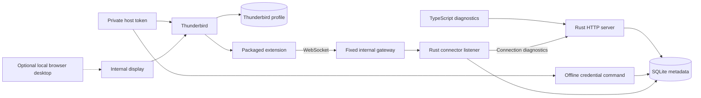

# Architecture

The [foundation decision](../decisions/20261017-thunderbird-first-foundation.md)
records the accepted product constraints. The
[SQLite decision](../decisions/20261018-sqlite-application-state.md) selects
application-state storage. The
[foundation plan](../planning/active/20261017-thunderbird-first-foundation.md)
is the specification for components, the connector, persistence, containers,
and implementation stages. This document separates the existing prototype
from that target.

## Current state

Docker Compose runs a Rust diagnostics server and an independently built
Thunderbird container. The server serves the TypeScript diagnostics page and
initializes SQLite with backend configuration and keys derived from the connector token. Its status reports
the [product version](versioning.md) and the build commit. Thunderbird owns a
separate profile volume. Its internal display starts without a viewer, and a
local override enables browser administration. Separate Compose networks prevent
Raicho from reaching Thunderbird's administrative listener. Both retain provider
internet access. The image includes a TypeScript extension with a persistent
background page and generated enterprise policy. It is inactive without managed
configuration. With provisioned credentials it connects outbound through a fixed
Nginx gateway to a separate Rust WebSocket listener. The gateway joins only two
internal networks, one shared with each service, so it is the only path between
them and has no egress. The browser displays authenticated connection status.
Browser login and mail operations remain planned.

A separate test-only extension and disposable GreenMail deployment exercise
mail API compatibility. A fixed SMTP/IMAP fault proxy and test controller run
on an internal network with a fresh fictional profile. These Python helpers
share the development tooling image. Thunderbird uses its
normal runtime image with read-only mounts for the mail test extension and
profile setup code. The production XPI has no mail permissions or probe commands. See the
[versioned compatibility matrix](mail-api-compatibility.md) for observed behavior
and the native consent and draft-editing gates.

The [connector contract](connector-contract.md) provides a shared control
schema, generated Rust/TypeScript bindings, and bounded decoders under
`protocol/rust/` and `protocol/typescript/`, used by the
server and production extension. It carries authentication and heartbeat only.
The separate mail probe remains a test artifact.

Offline credential commands acquire the database's exclusive instance lock.
A one-off `raicho-server connector files` container owns host token generation
and file rotation, with one operation lock spanning database and file updates. Only the one-off
provisioner and Thunderbird receive read-only raw tokens. Ordinary server
startup never imports tokens. The operational wrapper lives under
`deploy/credentials/`, and its file and live-check steps are server
subcommands, separate from disposable
acceptance drivers under `automation/acceptance/credentials/`. See the
[credential procedure](../operations/connector-credentials.md) for recovery.

The [runtime reference](runtime.md) describes endpoints, storage, migrations,
image packaging, and configuration. The existing showcase in `assets/brand/`
remains a separate static concept with fictional in-memory messages. Shared
Docker tooling runs language, application, and repository checks, and packages
the Python mocks and drivers used by disposable tests. Component-specific builders
and acceptance drivers live with their sources. Cross-component build dispatch,
connector/runtime acceptance, and shared development commands live in
responsibility-based `automation/` packages, while protocol generation belongs
to `protocol/generator/`. The
[shared test image decision](../decisions/20261026-repository-layout.md#tooling-image)
records that boundary. Fixtures and runtime tests live beside their owning
components, as described in [project structure](project-structure.md#test-code).
SQLFluff checks standalone production SQL embedded into the Rust executable,
using the same tooling image locally and in CI. See the
[Compose and SQL decision](../decisions/20261018-compose-layout-and-sql-quality.md).

## Target architecture

One Rust application server will serve a TypeScript browser client and its API.
A TypeScript extension inside Thunderbird will connect outbound to that server.
Docker Compose will run the server and Thunderbird as separate services with
separate volumes. One person owns each deployment. SQLite will run inside the
Rust process and store application state in the Raicho volume.

Thunderbird owns messages, accounts, provider credentials, drafts, and filters.
Raicho keeps login, preferences, and connector credentials in SQLite, and does
not persist mail or run a second filter engine. The browser talks to a Raicho mail
contract. Thunderbird-specific objects stay in the extension adapter. The current
gateway and control transport provide the connection boundary for those future operations.

The foundation plan holds the target component diagram, storage rules, backup
requirements, and stage gates. The
[mail API compatibility matrix](mail-api-compatibility.md) records mail API limitations.
Runtime diagnostics derive connector status from authenticated sessions and
heartbeats, never from a profile file or desktop listener.

## Status

Language choice, Docker deployment, single-user scope, Thunderbird ownership,
SQLite application storage, and
[product versioning](../decisions/20261018-product-versioning.md) are accepted
decisions. The
[runtime stack decision](../decisions/20261018-foundation-runtime-stack.md)
selects Axum, Tokio, SQLx, the initial SQLite configuration, and the independently
built Thunderbird image. The
[connector plan](../planning/done/20261018-foundation-stage-two-connector.md)
selects MV2 packaging, managed configuration, a fixed internal gateway, and a
versioned authenticated protocol. The mail compatibility
fixture and control contract have separate implementations.
Credential persistence, offline provisioning, production control transport, gateway,
and connection diagnostics are implemented. Dedicated CI jobs run the source and
unattended acceptance commands described in the
[acceptance record](connector-acceptance.md). The static showcase remains a design reference.

Current tooling commands and planned application commands are distinguished in
[build, test, and generate](build-test-generate.md).

See [project invariants](key-conventions.md) and the
[architecture update rule](../contributing/workflow.md#design-changes-and-completion).
