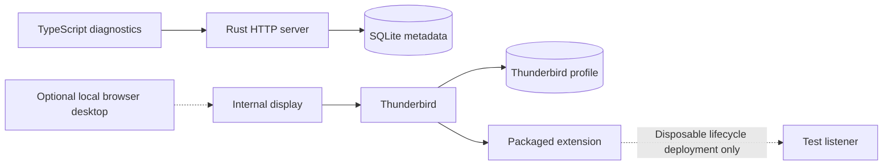

# Architecture

The [foundation decision](../decisions/20261017-thunderbird-first-foundation.md)
records the accepted product constraints. The
[SQLite decision](../decisions/20261018-sqlite-application-state.md) selects
application-state storage. The
[foundation plan](../planning/active/20261017-thunderbird-first-foundation.md)
is the specification for components, the connector, persistence, containers,
and implementation stages. This document separates the existing prototype
from that target.

## Current state

Docker Compose runs a Rust diagnostics server and an independently built
Thunderbird container. The server serves the TypeScript diagnostics page and
initializes SQLite, currently with migration metadata only. Thunderbird owns a
separate profile volume. Its internal display starts without a viewer, and a
local override enables browser administration. Separate Compose networks prevent
Raicho from reaching Thunderbird's administrative listener. Both retain provider
internet access. The image now includes a TypeScript extension with a persistent
background page and generated enterprise policy. It is inactive without managed
configuration. A separate disposable fixture exercises its lifecycle over
WebSocket. There is no production connection to Raicho or browser login yet.

A separate test-only extension and disposable GreenMail deployment exercise
mail API compatibility. A fixed SMTP/IMAP fault proxy and test controller run
on an internal network with a fresh fictional profile. The production XPI has
no mail permissions or probe commands. See the
[versioned compatibility matrix](mail-api-compatibility.md) for observed behavior
and the native consent and draft-editing gates.

The [connector contract](connector-contract.md) now provides a shared control
schema, generated Rust/TypeScript bindings, and bounded decoders. These modules
are tested independently. The server listener and production extension transport
have not adopted them yet.

The [runtime reference](runtime.md) describes endpoints, storage, migrations,
image packaging, and configuration. The existing showcase in `assets/brand/`
remains a separate static concept with fictional in-memory messages. Shared
Docker tooling runs language, application, and repository checks.
SQLFluff checks standalone production SQL embedded into the Rust executable,
using the same tooling image locally and in CI. See the
[Compose and SQL decision](../decisions/20261018-compose-layout-and-sql-quality.md).

## Target architecture

One Rust application server will serve a TypeScript browser client and its API.
A TypeScript extension inside Thunderbird will connect outbound to that server.
Docker Compose will run the server and Thunderbird as separate services with
separate volumes. One person owns each deployment. SQLite will run inside the
Rust process and store application state in the Raicho volume.

Thunderbird owns messages, accounts, provider credentials, drafts, and filters.
Raicho keeps login, preferences, and connector credentials in SQLite, and does
not persist mail or run a second filter engine. The browser talks to a Raicho mail
contract. Thunderbird-specific objects stay in the extension adapter.

The foundation plan holds the target component diagram, storage rules, backup
requirements, and stage gates. Mail integration starts with the stage 2 extension
lifecycle experiment. Runtime diagnostics never infer connector status from a
profile file or desktop listener. Stage 2 must establish an outbound connector
route while preserving the administrative network isolation.

## Status

Language choice, Docker deployment, single-user scope, Thunderbird ownership,
and SQLite application storage are accepted decisions. The
[runtime stack decision](../decisions/20261018-foundation-runtime-stack.md)
selects Axum, Tokio, SQLx, the initial SQLite configuration, and the independently
built Thunderbird image. The
[connector plan](../planning/active/20261018-foundation-stage-two-connector.md)
selects MV2 packaging, managed configuration, a fixed internal proxy, and a
versioned authenticated protocol. The lifecycle fixture is implemented first.
The mail compatibility fixture and control contract are implemented separately.
Production protocol integration, the proxy, and credential persistence remain
later slices. The static showcase remains a design reference.

Current tooling commands and planned application commands are distinguished in
[build, test, and generate](build-test-generate.md).

See [project invariants](key-conventions.md) and the
[architecture update rule](../contributing/workflow.md#design-changes-and-completion).
