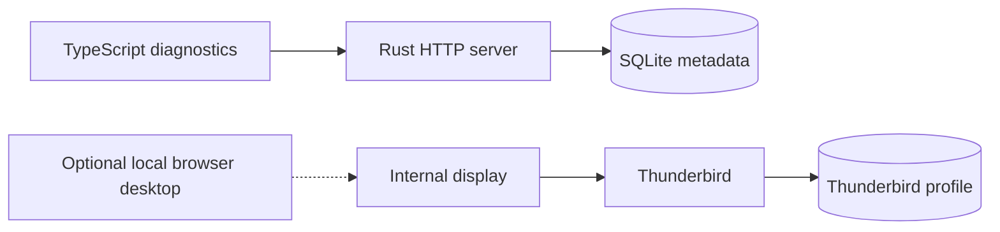

# Architecture

The [foundation decision](../decisions/20261017-thunderbird-first-foundation.md)
records the accepted product constraints. The
[SQLite decision](../decisions/20261018-sqlite-application-state.md) selects
application-state storage. The
[foundation plan](../planning/active/20261017-thunderbird-first-foundation.md)
is the specification for components, the connector, persistence, containers,
and implementation stages. This document separates the existing prototype
from that target.

## Current state

Docker Compose runs a Rust diagnostics server and an independently built
Thunderbird container. The server serves the TypeScript diagnostics page and
initializes SQLite, currently with migration metadata only. Its status reports
the [product version](versioning.md) and the build commit. Thunderbird owns a
separate profile volume. Its internal display starts without a viewer, and a
local override enables browser administration. Separate Compose networks prevent
Raicho from reaching Thunderbird's administrative listener. Both retain provider
internet access. There is no extension, live mail connection to Raicho, or
browser login yet.

The [connector contract](connector-contract.md) provides a shared control
schema, generated Rust/TypeScript bindings, and bounded decoders under
`protocol/rust/` and `protocol/typescript/`. It carries authentication and heartbeat only,
and every frame after the handshake carries a MAC under a per-session key.

The [runtime reference](runtime.md) describes endpoints, storage, migrations,
image packaging, and configuration. The existing showcase in `assets/brand/`
remains a separate static concept with fictional in-memory messages. Shared
Docker tooling runs language, application, and repository checks, and the
drivers used by disposable tests. Component-specific builders
and acceptance drivers live with their sources. Cross-component build dispatch,
runtime acceptance, and shared development commands live in
responsibility-based `automation/` packages, while protocol generation belongs
to `protocol/generator/`. The
[shared test image decision](../decisions/20261026-repository-layout.md#tooling-image)
records that boundary. Fixtures and runtime tests live beside their owning
components, as described in [project structure](project-structure.md#test-code).
SQLFluff checks standalone production SQL embedded into the Rust executable,
using the same tooling image locally and in CI. See the
[Compose and SQL decision](../decisions/20261018-compose-layout-and-sql-quality.md).

## Target architecture

One Rust application server will serve a TypeScript browser client and its API.
A TypeScript extension inside Thunderbird will connect outbound to that server.
Docker Compose will run the server and Thunderbird as separate services with
separate volumes. One person owns each deployment. SQLite will run inside the
Rust process and store application state in the Raicho volume.

Thunderbird owns messages, accounts, provider credentials, drafts, and filters.
Raicho keeps login, preferences, and connector credentials in SQLite, and does
not persist mail or run a second filter engine. The browser talks to a Raicho mail
contract. Thunderbird-specific objects stay in the extension adapter. The current
control transport provides the connection boundary for those future operations.

The foundation plan holds the target component diagram, storage rules, backup
requirements, and stage gates.
Runtime diagnostics derive connector status from authenticated sessions and
heartbeats, never from a profile file or desktop listener.

## Status

Language choice, Docker deployment, single-user scope, Thunderbird ownership,
SQLite application storage, and
[product versioning](../decisions/20261018-product-versioning.md) are accepted
decisions. The
[runtime stack decision](../decisions/20261018-foundation-runtime-stack.md)
selects Axum, Tokio, SQLx, the initial SQLite configuration, and the independently
built Thunderbird image. The
[direct connector listener decision](../decisions/20261026-thunderbird-connector.md#listener)
keeps Axum for the public listener and accepts connector WebSockets with
tokio-tungstenite. The
[connector plan](../planning/active/20261018-foundation-stage-two-connector.md)
selects MV2 packaging, managed configuration, a fixed internal gateway, and a
versioned authenticated protocol.
The shared connector contract and its generated bindings are implemented. The
server listener, credential storage, connection diagnostics, extension, and
gateway are not. The static showcase remains a design
reference.

Current tooling commands and planned application commands are distinguished in
[build, test, and generate](build-test-generate.md).

See [project invariants](../contributing/key-conventions.md) and the
[architecture update rule](../contributing/workflow.md#design-changes-and-completion).
