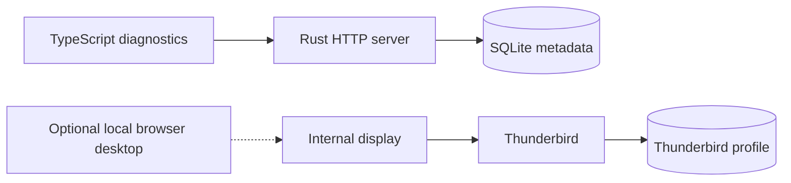

# Architecture

The [foundation decision](../decisions/20261017-thunderbird-first-foundation.md)
records the accepted product constraints. The
[SQLite decision](../decisions/20261018-sqlite-application-state.md) selects
application-state storage. The
[foundation plan](../planning/active/20261017-thunderbird-first-foundation.md)
is the specification for components, the connector, persistence, containers,
and implementation stages. This document separates the existing prototype
from that target.

## Current state

Docker Compose runs a Rust diagnostics server and an independently built
Thunderbird container. The server serves the TypeScript diagnostics page and
initializes SQLite, currently with migration metadata only. Thunderbird owns a
separate profile volume. Its internal display starts without a viewer, and a
local override enables browser administration. There is no extension, live mail
connection to Raicho, or browser login yet.

The [runtime reference](runtime.md) describes endpoints, storage, migrations,
image packaging, and configuration. The existing showcase in `assets/brand/`
remains a separate static concept with fictional in-memory messages. Shared
Docker tooling runs language, application, and repository checks.

## Target architecture

One Rust application server will serve a TypeScript browser client and its API.
A TypeScript extension inside Thunderbird will connect outbound to that server.
Docker Compose will run the server and Thunderbird as separate services with
separate volumes. One person owns each deployment. SQLite will run inside the
Rust process and store application state in the Raicho volume.

Thunderbird owns messages, accounts, provider credentials, drafts, and filters.
Raicho keeps login, preferences, and connector credentials in SQLite, and does
not persist mail or run a second filter engine. The browser talks to a Raicho mail
contract. Thunderbird-specific objects stay in the extension adapter.

The foundation plan holds the target component diagram, storage rules, backup
requirements, and stage gates. Mail integration starts with the stage 2 extension
lifecycle experiment. Runtime diagnostics never infer connector status from a
profile file or desktop listener.

## Status

Language choice, Docker deployment, single-user scope, Thunderbird ownership,
and SQLite application storage are accepted decisions. The
[runtime stack decision](../decisions/20261018-foundation-runtime-stack.md)
selects Axum, Tokio, SQLx, the initial SQLite configuration, and the independently
built Thunderbird image. WebSocket lifecycle, the eventual UI framework, and
authentication details remain later implementation gates. The static showcase
remains a design reference.

Current tooling commands and planned application commands are distinguished in
[build, test, and generate](build-test-generate.md).

See [project invariants](key-conventions.md) and the
[architecture update rule](../contributing/workflow.md#design-changes-and-completion).
