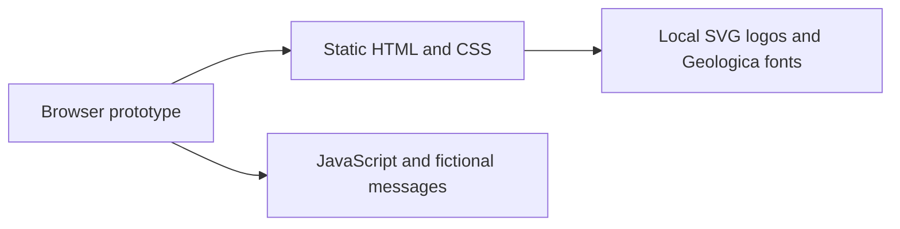

# Architecture

The [foundation decision](../decisions/20261017-thunderbird-first-foundation.md)
records the accepted product constraints. The
[SQLite decision](../decisions/20261018-sqlite-application-state.md) selects
application-state storage. The
[foundation plan](../planning/active/20261017-thunderbird-first-foundation.md)
is the specification for components, the connector, persistence, containers,
and implementation stages. This document separates the existing prototype
from that target.

## Current state

The repository contains static visual prototypes. A local HTTP server serves
HTML, CSS, JavaScript, fonts, and SVGs from `assets/brand/`. Inbox interactions
operate on fictional in-memory messages. There is no production server, extension,
live Thunderbird connection, authentication service, or application Compose
deployment yet. Docker Compose already runs repository checks and language tools
through a shared tooling image, as recorded in the
[code-quality decision](../decisions/20261018-containerized-code-quality.md).

## Target architecture

One Rust application server will serve a TypeScript browser client and its API.
A TypeScript extension inside Thunderbird will connect outbound to that server.
Docker Compose will run the server and Thunderbird as separate services with
separate volumes. One person owns each deployment. SQLite will run inside the
Rust process and store application state in the Raicho volume.

Thunderbird owns messages, accounts, provider credentials, drafts, and filters.
Raicho keeps login, preferences, and connector credentials in SQLite, and does
not persist mail or run a second filter engine. The browser talks to a Raicho mail
contract. Thunderbird-specific objects stay in the extension adapter.

The foundation plan holds the component diagram, storage rules, migrations,
backup requirements, container behavior, and stage gates. Application stages
remain pending. Their shared tooling was brought forward independently.

## Status

Language choice, Docker deployment, single-user scope, Thunderbird ownership,
and SQLite application storage are accepted decisions. Axum, Tokio, WebSocket,
the UI framework, authentication details, SQLite library/configuration, and
application dependency/image pins remain the plan's open implementation gates.
Development tool versions are already pinned. The static
showcase remains a design reference.

Current tooling commands and planned application commands are distinguished in
[build, test, and generate](build-test-generate.md).

See [project invariants](key-conventions.md) and the
[architecture update rule](../contributing/workflow.md#design-changes-and-completion).
