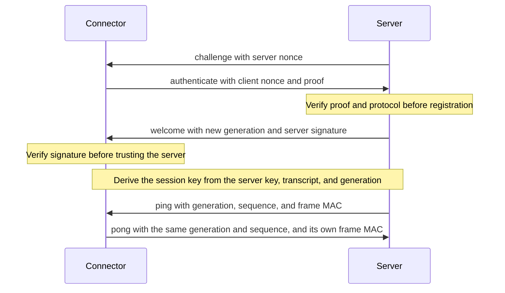

# Connector contract

The first connector contract defines connection control only. The production
Rust listener and TypeScript extension use its generated bindings and boundary
decoders for authentication and heartbeat. The
[acceptance record](connector-acceptance.md) describes production validation and
the [connector plan](../planning/done/20261018-foundation-stage-two-connector.md)
records the approved design.

See [architecture](architecture.md) for component boundaries and
[mail API compatibility](mail-api-compatibility.md) for the separate experiment.
No fixture command, account identity, message handle, or mail content belongs in
this contract. The backend kind is an identifier, not a Thunderbird-specific type.

Offline [credential provisioning](../operations/connector-credentials.md)
persists one active credential or a revoked record. The Rust `Credential::parse`
boundary derives two keys from the canonical 64-character lowercase hexadecimal
token. The stored key verifies the connector's proof, and the server key signs
the server's reply and keys every later frame. A database copy alone cannot
produce a connector proof. Combined with one captured `authenticate` frame and its
challenge, though, the stored key recovers the connector key, because the proof is
that key XOR an HMAC under the stored key, and the server key derives every
session key from the public transcript. Rotate the credential when the database
may have leaked. The token never crosses the connection, and an incoming frame
never enrolls a token. See the
[handshake decision](../decisions/20261026-thunderbird-connector.md#handshake) and
the [frame authentication decision](../decisions/20261026-thunderbird-connector.md#frame-authentication).

## Sources and generated outputs

- [Schema](../../protocol/schema/connector.schema.json): Draft 7, closed tagged
  objects and local definitions only. The generation guard restricts its vocabulary.
- [Limits](../../protocol/limits.json): shared constants, including frame sizes,
  authentication deadline, heartbeat timing, nesting, connection budgets, and
  the WebSocket close codes the server sends.
- [Diagnostics](../../protocol/diagnostics.json): the backend states and error
  codes that the status API reports, and the decoder error codes. They generate
  Rust enums, including `ContractError`, and the TypeScript `ContractErrorCode`.
  Every protocol error code must also be a backend error, and every decoder error
  a protocol error code.
- [Status schema](../../protocol/schema/status.schema.json): the `/api/status`
  response. Its state and error lists must equal the diagnostics. It generates
  the browser's `web/src/status_generated.ts` types and bundled
  `status_validator_generated.js`, and shared documents in
  `protocol/fixtures/status/` run against the Rust and browser validators.
- [Shared fixtures](../../protocol/fixtures/): the same accepted/rejected frames,
  phases, expected generations, and error codes run in both languages.
- [Rust crate](../../protocol/rust/src/lib.rs): generated types and limits, and a
  boundary decoder. The decoder relies on the generated types, which enforce the
  schema's types, lengths, patterns, and unknown-field rules, and checks the two
  bounds they miss itself: empty `capabilities` and the `sequence` maximum. A
  conformance test runs every shared fixture through offline `jsonschema`
  validation, which is a test-only dependency, and fails when a frame that the schema
  rejects decodes.
- [TypeScript project](../../protocol/typescript/src/decode_frame.ts): generated
  types and limits with a bundled Ajv standalone validator. No runtime Ajv,
  network schema retrieval, Node imports, or dynamic code generation is required.
- [Generation scripts](../../protocol/generator/): Python orchestration and
  JavaScript generation, with regression tests in its `tests/` directory.

Both implementations live under `protocol/`, with their own tests. The TypeScript
project is private ES modules and imports no Thunderbird APIs. The extension
imports those sources directly. Its XPI preserves the compiled `extension/src/`
and `protocol/typescript/src/` paths so browser module imports resolve inside the
archive. The background page remains at the archive root. Protocol fixtures and
tests are excluded from production packaging.

Use the boundary decoder on untrusted input. Deserializing a generated type or
calling the schema validator alone does not enforce frame size, phase, generation,
duplicate-member, or parsing rules. A valid authentication frame does not prove
that its proof is accepted. Wire structs omit Rust `Debug`, and decoder errors
contain fixed codes without rejected input.

## Envelopes and direction

Every envelope carries `type` and `protocol_version: 1`. Additional members and
unknown message types are rejected. The first version accepts an empty capability
list only. Heartbeat is mandatory connection control, not an advertised mail feature.

| Type | Direction and phase | Fields beyond the common envelope |
| --- | --- | --- |
| `challenge` | Server to connector, `challenge` | 256-bit server nonce |
| `authenticate` | Connector to server, `authentication` | 256-bit client nonce and proof, backend kind/version, connector version, empty capabilities |
| `welcome` | Server to connector, `handshake` | Server-issued generation, server signature, empty capabilities. Both sides take heartbeat timing from `protocol/limits.json` |
| `ping` | Server to connector, `server_control` | Current generation, bounded positive sequence, and frame MAC |
| `pong` | Connector to server, `client_control` | Current generation, echoed sequence, and frame MAC |
| `error` | Server to connector, challenge, handshake, or control | Enumerated code, generation and frame MAC only after negotiation |

The decoder rejects a challenge or handshake error carrying a generation or MAC.
A control frame requires the current generation and a MAC. A connector cannot send an error envelope.
Error codes contain no free-text details or echoed credential. Supported codes
are defined in the schema, rather than accepted as arbitrary strings.

## Integration semantics

The internal listener accepts only the exact connector path, a single canonical
`moz-extension://<UUID>` Origin, and no WebSocket subprotocol. Origin is an
additional boundary check, not a substitute for the credential.



The server sends a fresh challenge as soon as the upgrade completes, then accepts
one authentication frame within the shared deadline. Both sides build the same
transcript from the two nonces and the authentication metadata, as defined in
`protocol/rust/src/authentication.rs` and `protocol/typescript/src/authentication.ts`
and pinned by `protocol/fixtures/authentication/vector.json`. The connector key
is an HMAC-SHA256 of a fixed label under the token, and the stored key is its
SHA-256. The proof is the connector key XOR an HMAC of the transcript under the
stored key. The server recovers the connector key, checks its hash against the
stored key in constant time, and signs the transcript with the server key. A
replayed proof fails because each connection has a new server nonce. The server
verifies the proof before issuing a fresh random 128-bit generation and
registering the connection. The generation belongs to this connection, is never a
durable backend identity, and changes on replacement. Fencing and stale cleanup
compare it. Startup with an active credential begins disconnected. An authenticated
replacement fences the prior session, whose cleanup cannot clear the new state.

## Frame authentication

After welcome, every frame carries a `mac`. Both sides derive the session key as
an HMAC-SHA256 under the server key of `raicho-connector-session`, the transcript,
and the generation, each on its own line. The connector derives the server key
from its token. A tampered welcome generation therefore yields a different key on
each side, so the first frame fails. Each frame's MAC is an HMAC-SHA256 under the
session key of `raicho-connector-frame`, the sender (`server` or `client`), the
sender's frame counter, and the canonical JSON of the frame without `mac`, each on
its own line. Counters start at zero after welcome, count every frame each side
sends, and never appear on the wire, so a replayed, reordered, reflected, or dropped
frame fails. Canonical JSON sorts object members and has no whitespace, which is
unambiguous because wire values are printable ASCII and integers.
`protocol/rust/src/channel.rs` and `protocol/typescript/src/channel.ts` implement
it, pinned by `protocol/fixtures/authentication/session.json`. The decoders check
the schema, phase, and generation first, then the MAC. A frame that fails the MAC
ends the session with `authentication_failed`. Frames are authenticated, not
encrypted, because the gateway between the networks has no outbound route.

The server initiates heartbeat after welcome, with at most one outstanding ping.
Only its matching pong satisfies that ping. It uses the shared 15-second interval
and 45-second timeout and reconnects before sequence overflow. The decoder checks
generation and range, while the transport checks the outstanding sequence and
elapsed time.

An error is terminal for the connection. The connector trusts no close code and
no frame it cannot authenticate, so it retries with backoff after every close,
decoding failure, unauthenticated error, or MAC failure, and a spoofed endpoint or
injected frame cannot stop it. A wrong token therefore retries at the capped
interval while the server records `authentication_failed`. Only an authenticated
`session_replaced` error stops reconnect attempts, until Thunderbird restarts, so
two connectors with the same token do not compete. Transient disconnects use
exponential backoff with jitter capped at 30 seconds, reset after a valid heartbeat.
Managed policy changes require Thunderbird restart. No command or mail operation
is replayed.

The internal listener accepts the WebSocket upgrade itself with tokio-tungstenite,
without an HTTP framework. It holds at most nine sockets, one active session plus
twice the four pending authentications, so excess upgrades still receive a 503.
The upgrade request must fit 8 KiB. Requests for another path receive 404, and a
query, a missing or malformed `moz-extension` origin, or a subprotocol receives
403. One five-second deadline starts when the TCP connection is accepted and covers
the upgrade, the challenge, the 4 KiB authentication frame, and the credential
lookup. A credential lookup that fails or outlasts the deadline closes with
retryable `server_busy` instead of an authentication rejection. A connection lost without
a close frame is recorded as `disconnected`, and a frame over the transport limit
as `message_too_large`. The WebSocket allocation
limit is 64 KiB even before authentication, and control frames have the same
64 KiB limit. Writes are bounded to five seconds. Neither endpoint maintains an
application send queue.
The extension retries if its browser socket already has buffered data. Server
shutdown closes sessions before releasing database ownership.

## Versioning

Both sides require `protocol_version` to equal the shared limit exactly. There is
no negotiated range, because the server and Thunderbird images are built from one
commit and upgraded together, as the
[version policy](../decisions/20261026-thunderbird-connector.md#versioning)
records. A version mismatch fails before authentication with
`incompatible_version`, so a connector retries until both sides match. A protocol
change bumps the version and ships in one release of both images.

## Parsing and limits

Frame budgets count UTF-8 bytes, including whitespace, before JSON decoding.
The authentication phase uses its smaller budget. Every object key and string
value must be printable ASCII. These are control envelopes, so this restriction
does not define the encoding of future mail content.

Native WebSocket Ping/Pong frames are handled separately. They neither
authenticate a connection nor satisfy or extend the application heartbeat.
Binary application frames are rejected.

Reject duplicate object members, including keys spelled with equivalent JSON
escapes. Reject nesting deeper than the shared limit, measured with the root at
depth zero. Reject non-finite numbers and invalid JSON. These checks happen before
version classification. An unsupported positive integer version within the
32-bit signed range produces `incompatible_version`. Malformed versions produce
`invalid_message`. Schema validation precedes phase and generation checks.

Equivalent integral numeric spellings such as `1`, `1.0`, and `1e0` are accepted.
Rust normalizes validated integral values before generated-type deserialization.
Sequences remain within the shared schema's 32-bit signed range, avoiding loss of
precision in JavaScript. Boundary, decimal-rounding, duplicate, surrogate, and
nesting regressions exercise agreement between the two decoders.

## Generation and verification

```bash
docker compose -f automation/tooling/compose.yaml build
LOCAL_UID="$(id -u)" LOCAL_GID="$(id -g)" \
  docker compose -f automation/tooling/compose.yaml run --rm format make generate-protocol
docker compose -f automation/tooling/compose.yaml run --rm check make check-protocol test-protocol
```

Set `LOCAL_UID` and `LOCAL_GID` for writable generation as described in
[build commands](build-test-generate.md#checks-and-formatting). Generation builds
both language outputs in temporary directories before publishing changed files.
The check regenerates and compares bytes without changing the checkout. The
Python entry point validates every source before either generator runs. Schema
constants must agree with the limits file. Remote, file, and missing references
fail before generation. Review schema, generated changes, and corpus together.

`make lint` includes generation drift checks. `test-protocol` runs the
independently compiled TypeScript protocol suite. `test-server` covers the Rust
protocol crate and generator with the rest of the workspace, and `test-extension`
covers the compiled extension, including shared contract fixtures.
Packaging tests require the production validator and exclude it from the separate
mail probe. The CSP test loads the standalone artifact with dynamic code
generation disabled. The [acceptance record](connector-acceptance.md) describes
the connector lifecycle checks that CI runs.
