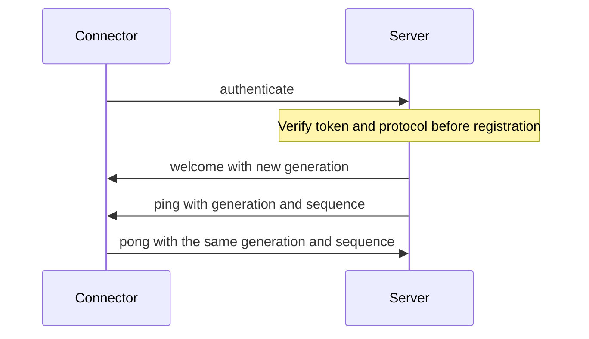

# Connector contract

The first connector contract defines connection control only. Its schema,
generated Rust/TypeScript bindings, and boundary decoders exist. The production
server and extension do not use them yet. Credential verification, socket
registration, timers, and proxy integration remain later slices of the
[connector plan](../planning/active/20261018-foundation-stage-two-connector.md).

See [architecture](architecture.md) for component boundaries and
[mail API compatibility](mail-api-compatibility.md) for the separate experiment.
No fixture command, account identity, message handle, or mail content belongs in
this contract. The backend kind is an identifier, not a Thunderbird-specific type.

## Sources and generated outputs

- [Schema](../../protocol/schema/connector.schema.json): Draft 7, closed tagged
  objects and local definitions only. The generation guard restricts its vocabulary.
- [Limits](../../protocol/limits.json): shared constants, including frame sizes,
  authentication deadline, heartbeat timing, nesting, and future connection budgets.
- [Shared fixtures](../../protocol/fixtures/): the same accepted/rejected frames,
  phases, expected generations, and error codes run in both languages.
- [Rust crate](../../protocol/rust/src/lib.rs): generated types and limits,
  embedded offline `jsonschema` validation, and a boundary decoder.
- [Extension decoder](../../extension/src/contract/decode_frame.ts): generated
  types and limits with a bundled Ajv standalone validator. No runtime Ajv,
  network schema retrieval, Node imports, or dynamic code generation is required.

Use the boundary decoder on untrusted input. Deserializing a generated type or
calling the schema validator alone does not enforce frame size, phase, generation,
duplicate-member, or parsing rules. A valid authentication frame does not prove
that its token is accepted. Wire structs omit Rust `Debug`, and decoder errors
contain fixed codes without rejected input.

## Envelopes and direction

Every envelope carries `type` and `protocol_version: 1`. Additional members and
unknown message types are rejected. The first version accepts an empty capability
list only. Heartbeat is mandatory connection control, not an advertised mail feature.

| Type | Direction and phase | Fields beyond the common envelope |
| --- | --- | --- |
| `authenticate` | Connector to server, `authentication` | 256-bit lowercase hexadecimal token, backend kind/version, connector version, empty capabilities |
| `welcome` | Server to connector, `handshake` | Server-issued generation, empty capabilities, fixed heartbeat interval/timeout |
| `ping` | Server to connector, `server_control` | Current generation and bounded positive sequence |
| `pong` | Connector to server, `client_control` | Current generation and echoed sequence |
| `error` | Server to connector, handshake or control | Enumerated code, generation only after negotiation |

The decoder rejects a handshake error carrying a generation. A control error
requires the current generation. A connector cannot send an error envelope.
Error codes contain no free-text details or echoed credential. Supported codes
are defined in the schema, rather than accepted as arbitrary strings.

## Integration semantics

These requirements describe the later transport implementation. Pure decoding
does not establish that they are running in the current application.



The server accepts one authentication frame within the shared deadline. It verifies
the credential digest before issuing a fresh random 128-bit generation and
registering the connection. The generation belongs to this connection, is never a
durable backend identity, and changes on replacement. Fencing and stale cleanup
must compare it. Startup begins disconnected.

The server initiates heartbeat after welcome, with at most one outstanding ping.
Only its matching pong satisfies that ping. Use the shared interval and timeout,
reconnect before sequence overflow, and never wrap a sequence in the same
generation. The decoder checks the generation and sequence range. The transport
must check the outstanding sequence and elapsed time.

An error is terminal for the connection. Authentication or protocol-version
rejection stops reconnect attempts until configuration changes or the extension
restarts. Transient disconnects use the plan's bounded backoff. No pending command
or mail operation is replayed. The fixed connection/queue budgets in `limits.json`
must be enforced by the transport before claiming them as runtime protections.

## Parsing and limits

Frame budgets count UTF-8 bytes, including whitespace, before JSON decoding.
The authentication phase uses its smaller budget. Every object key and string
value must be printable ASCII. These are control envelopes, so this restriction
does not define the encoding of future mail content.

Reject duplicate object members, including keys spelled with equivalent JSON
escapes. Reject nesting deeper than the shared limit, measured with the root at
depth zero. Reject non-finite numbers and invalid JSON. These checks happen before
version classification. An unsupported positive integer version within the
32-bit signed range produces `incompatible_version`. Malformed versions produce
`invalid_message`. Schema validation precedes phase and generation checks.

Equivalent integral numeric spellings such as `1`, `1.0`, and `1e0` are accepted.
Rust normalizes validated integral values before generated-type deserialization.
Sequences remain within the shared schema's 32-bit signed range, avoiding loss of
precision in JavaScript. Boundary, decimal-rounding, duplicate, surrogate, and
nesting regressions exercise agreement between the two decoders.

## Generation and verification

```bash
docker compose -f compose/compose.tools.yaml build
docker compose -f compose/compose.tools.yaml run --rm format make generate-protocol
docker compose -f compose/compose.tools.yaml run --rm check make check-protocol test-protocol
```

Set `LOCAL_UID` and `LOCAL_GID` for writable generation as described in
[build commands](build-test-generate.md#checks-and-formatting). Generation builds
both language outputs in temporary directories before publishing changed files.
The check regenerates and compares bytes without changing the checkout. Schema
constants must agree with the limits file. Remote, file, and missing references
fail before generation. Review schema, generated changes, and corpus together.

`make lint` includes generation drift checks. Existing application tests cover
the Rust workspace and compiled extension, including shared contract fixtures.
Packaging tests require the production validator and exclude it from the separate
mail probe. The CSP test loads the standalone artifact with dynamic code
generation disabled. Actual connector lifecycle CI remains a later slice.
